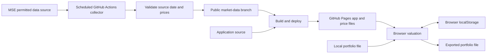

# MSE portfolio tracker — project plan

Planning date: 30 October 2026. Status: proposal; application implementation has not started.

Build a public website that answers: **What are my Mongolian shares worth, and how much have I gained or lost?** The code will be public and the website hosted on GitHub Pages. Visitors can import, edit, and export their portfolios, with holdings stored in their browser and no application database.

## Confirmed requirements

- Track stocks listed on the Mongolian Stock Exchange (MSE).
- Collect stock prices every day.
- Show portfolio profit/loss based on the user's holdings.
- Use [Tax UI](https://tax-ui.brianlovin.com/) as an interface reference, adapting its summary-and-table structure to investments.
- Publish the project publicly and host it on GitHub Pages.
- Support portfolio import and export; keep visitors' holdings in their browser.
- The owner is comfortable publishing their own holdings. This does not make visitors' imported portfolios public.
- Produce a plan first.

Working interpretation: “margin” means investment profit/loss, rather than borrowing on margin. Currency is MNT (₮). Both remain planning assumptions until corrected.

## Recommended first release

Start with **current holdings and unrealized profit/loss**. Each position contains a symbol, share quantity, average purchase price, and optional purchase fees. This gives a useful result without requiring years of transaction records.

| Capability | First-release behavior |
| --- | --- |
| Portfolio summary | Total purchase cost, current market value, unrealized gain/loss in ₮ and percent |
| Holdings table | Symbol, company, shares, average cost, latest close, market value, gain/loss, gain/loss %, price date |
| Edit holdings | Add, edit, and remove positions; search by ticker or company |
| Import | CSV template and versioned JSON backup; show a preview and errors before replacing the current portfolio |
| Export | CSV for spreadsheets and lossless JSON for restoring the portfolio |
| Browser storage | Versioned localStorage, using an application-specific key |
| Public example | Clearly labeled example portfolio; optionally replace it with the owner's deliberately published holdings |
| Data status | Source date, collection time, missing-price count, and visible old-price warnings |
| Devices | Usable desktop table and compact mobile view with access to the same figures |

Use the public example only when the visitor chooses it. Importing or editing a personal portfolio must never modify a shared example or publish personal holdings. No automatic public-sharing link in version one: export provides deliberate file sharing.

Browser storage is local to that browser profile, with no account or device sync. Clearing site data can remove holdings, so export/restore is part of the first release. Import means opening a file locally; its contents are not uploaded to an application server.

### Later releases

1. Record buys, sells, dividends, and fees; calculate realized gains with a documented portfolio cost-basis method.
2. Add stock price history and portfolio history where dated holdings/transactions support it.
3. Add Mongolian/English switching, allocation views, watchlists, and multiple portfolios as needed.

Do not infer historical portfolio returns from today's holdings. Deposits, purchases, sales, dividends, and corporate actions affect those results. A stock price chart can arrive before a true portfolio performance chart.

Tax calculation, brokerage integration, leverage, order placement, other asset classes, and accounts are outside the initial scope.

## Interface direction

The reference's useful pattern is prominent totals above a detailed financial table, with compact navigation. Adapt the information hierarchy instead of copying its tax categories or chat feature.

Proposed first screen:

```text
Equities                              Import  Export  Add holding
Your portfolio                        Prices as of [source date]

Purchase cost         Market value         Unrealized gain/loss
₮ ...                 ₮ ...                +₮ ... / +...%

Search holdings ...                   [data status, if needed]
Symbol  Company  Shares  Avg cost  Close  Value  Gain/loss  Price date
...
```

Use a restrained financial-table layout, clear alignment, tabular numbers, and signs/labels alongside gain/loss colors. Preserve precise numbers in the table; abbreviated totals can reveal full amounts. Make forms keyboard accessible and keep imported company names as text.

The first release shows the latest available closing-price valuation. Add date filters only when the underlying historical data can support their meaning. This is a proposed direction; exact typography, colors, and detailed visual design remain for implementation.

## Hosting and data architecture

[GitHub Pages serves static HTML, CSS, and JavaScript](https://docs.github.com/en/pages/getting-started-with-github-pages/what-is-github-pages). Run unattended collection in GitHub Actions, then publish static price files with the app.



No holdings enter the collection workflow. Collect the supported equity universe independently of visitors' portfolios. The browser reads same-origin published JSON rather than contacting MSE directly; this also avoids depending on MSE allowing browser cross-origin requests.

### Proposed stack

| Part | Recommendation | Reason |
| --- | --- | --- |
| Frontend | React + TypeScript + Vite | Small static application with editable tables and import/export |
| Styling | CSS with shared tokens | Focused, consistent interface without a large UI framework |
| Calculations | Decimal arithmetic library | Explicit financial rounding and reproducible calculations |
| Collection | Node.js/TypeScript source adapter | Share schemas, validation, and tooling with the app |
| Persistence | Browser localStorage; exported files | Meets the no-database requirement |
| Market archive | JSON on a dedicated `market-data` branch | Auditable daily observations without daily changes to application source |
| Delivery | GitHub Actions → GitHub Pages | Fits the requested public repository and hosting |
| Checks | Calculation/parser tests and a small browser smoke suite | Covers the parts most likely to produce misleading results |

The stack is a recommendation, not a confirmed user preference. A plain TypeScript/Vite implementation is also viable if minimizing framework dependencies is preferred. No server framework is required for this scope.

For a project URL such as `https://<owner>.github.io/<repo>/`, configure Vite's base path and all data/asset URLs for that repository prefix. Use one screen initially; hash navigation can support later sections without server rewrites. [Vite's GitHub Pages deployment guide](https://vite.dev/guide/static-deploy.html#github-pages) documents the base-path and Actions setup.

## MSE source findings and first milestone

Follow-up research found a directly parsable stock directory at [MSE Open](https://open.mse.mn/securities) and working per-company trading-history fragments. See [the detailed investigation](research/mse-listings.md) and [read-only directory probe](research/mse_listings_probe.py). The observed directory has 160 listed-tier entries, while the newer issuer hub reports 162; completeness remains unreconciled. Sample dated prices can be extracted without a browser, but a production feed, efficient bulk collection, CI access, and redistribution terms remain unverified. The following initial findings are retained as context.

Research confirmed that MSE has a [live-market page](https://new.mse.mn/live-market) and a [today's-trade page](https://new.mse.mn/todays-trade?lang=en). The latter distinguishes last price, previous close, closing price, volume, and asset categories. Its ordinary HTML response did not provide usable populated price rows during this inspection. This identifies a candidate source, but does not verify a working unattended collector.

MSE also publishes [dated daily trading announcements](https://new.mse.mn/news/10-dugaar-saryn-29-nii-odriin-ariljaany-medee) and [daily report PDFs](https://mse.mn/uploads/ariljaa/reports/report_mn-11.pdf). A sample PDF exposes closing-price fields, but its filename is not proof of a stable date-addressable archive. Summary announcements alone do not contain the full closing-price universe.

An HTTP inspection of [the new site's robots file](https://new.mse.mn/robots.txt) returned disallows for `/api` and `/_next`, among other paths. Do not base the crawler on those disallowed paths. Public display of prices does not establish permission to redistribute a daily dataset. A supported API, automated-access terms, historical coverage, and republication rights have **not been verified**.

Before connecting live data:

1. Identify an official feed, download, or permitted public report source with complete equity close data and an explicit source date.
2. Verify automated access and public redistribution terms for that source; document attribution and any fees or credentials.
3. Retrieve a small sample of recent sessions, including a no-trade case, and compare representative stocks with MSE's published figures.
4. Confirm instrument identifiers, symbol changes, currencies, volume, and exactly what “closing price” means in the selected source.
5. Run the collector in GitHub-hosted CI to establish that the source works there, without depending on a signed-in browser.

Prefer a documented structured feed/download. Use HTML or PDF parsing only where access is permitted and reliability is demonstrated. If public redistribution is unavailable, the same app can use user-imported price files while a permitted source is arranged. Keep that fallback clearly labeled; it does not fulfill the daily automatic-feed milestone.

UI work can use synthetic, labeled fixtures while this source investigation runs. Shipping the automatic public feed depends on this milestone passing.

## Daily collection and publication

MSE's [working-hours page](https://members.mse.mn/en/aboutus_en) lists regular trading at 10:00–13:00 and closing-price publication at 13:00–13:05. Propose a daily collection at **18:17 Asia/Ulaanbaatar**, allowing time for end-of-day reports. Verify the selected source's actual publication delay during the first milestone.

The workflow should:

1. Fetch the selected permitted source using bounded timeouts and retries.
2. Extract the source's session date; never substitute the runner's current date for a missing source date.
3. Validate the schema, currency, stock coverage, duplicate identifiers, prices, and session date before publishing anything.
4. Save a date-keyed snapshot and update a latest-data manifest only after validation. A rerun must not append duplicate sessions; verified source corrections remain auditable.
5. Commit only approved market files to `market-data`, then build and deploy the application with that validated data revision.
6. On failure, preserve the previous successful snapshot and deployment, fail visibly in Actions, and let the app indicate the age of its last available data.

Run the scheduled check every calendar day. Weekends and confirmed holidays can produce a successful no-new-session result, without fabricating new prices. Unexplained missing weekday data remains a warning/failure rather than being silently classified as a holiday.

[GitHub documents that schedules can be delayed or dropped, run on the default branch, and can be disabled after 60 days without public-repository activity](https://docs.github.com/en/actions/reference/workflows-and-actions/events-that-trigger-workflows#schedule). Provide manual refresh and date-range backfill commands, and show source dates in the UI rather than promising a precise daily delivery time.

Use a shared deploy job/workflow invoked explicitly after collection. A commit made with `GITHUB_TOKEN` should not be expected to trigger the normal push deployment: [GitHub suppresses most workflow events generated by that token](https://docs.github.com/en/actions/how-tos/write-workflows/choose-when-workflows-run/trigger-a-workflow#triggering-a-workflow-from-a-workflow). Serialize publication so an older concurrent run cannot replace a newer data revision.

PR checks receive read-only permissions and no deployment credentials. Give only the collection job repository write access, and only the deployment job Pages permissions. If a permitted feed requires a credential, keep it in Actions secrets and exclude it from the frontend, exported files, and logs.

## Data and calculation rules

### Private portfolio file

Versioned JSON is the complete backup format. CSV contains the same position fields:

```csv
symbol,quantity,averagePurchasePriceMnt,purchaseFeesMnt
DEMO,100,1000.00,100.00
```

`DEMO` is a synthetic illustration, not an actual MSE symbol. Average purchase price excludes the separately supplied fees. Document that rule in the importer so fees are not counted twice. Validate positive quantities, nonnegative costs/fees, decimal formats, and duplicate rows. Flag unknown symbols for correction rather than matching them approximately to a different stock.

Export decimal values without precision loss. Failed or cancelled imports leave the existing portfolio intact. A successful replacement must exactly restore the exported positions; JSON includes `schemaVersion` for future migrations.

### Public prices

Store the source URL, source session date, collection timestamp, currency, canonical instrument key, symbol, close, previous close if available, volume if available, and per-quote price date/status. The instrument master must support aliases and source identifiers; ticker strings are not assumed immutable.

Separate these situations:

- A valid close for the latest session.
- An explicitly confirmed no-trade session, where a prior validated close may be carried forward with its original price date.
- A missing/invalid price, an unavailable source, or an unresolved symbol.
- A suspended/delisted security or corporate action needing review.

Never turn an empty value into zero. Display the date of the price actually used. If some holdings cannot be priced, label totals incomplete and show which positions are excluded. Calculate gain/loss on the matched, priced positions only; do not subtract all holdings' costs from a partial market value.

### First-release formulas

For quantity `q`, average purchase price `a`, separately recorded purchase fees `f`, and latest validated closing price `p`:

```text
purchase cost       = q × a + f
market value        = q × p
unrealized P/L      = market value − purchase cost
unrealized P/L %    = unrealized P/L ÷ purchase cost × 100
```

Calculate with full decimal precision and round for display. When purchase cost is zero, show the monetary gain and an undefined percentage (`—`). Portfolio return is total gain/loss divided by the corresponding total cost, rather than the average of position percentages.

Example: 100 shares bought at ₮1,000 with ₮100 in fees and a ₮1,200 close have a ₮100,100 cost, ₮120,000 value, and **₮19,900 unrealized gain (19.88%)**.

These are closing-price valuations, before future selling fees and taxes. Purchase fees are included only when entered. Dividends and realized gains are outside the first-release calculation. A change in today's quantity must not be presented as historical investment performance.

## Delivery milestones

| Milestone | Deliverable | Acceptance condition |
| --- | --- | --- |
| 0 — Data feasibility | Source findings, access terms, source adapter prototype | Permitted source works unattended in CI; sample closes and dates match official records |
| 1 — Working local portfolio | Summary, holdings editor, import/export, browser persistence | A visitor restores a portfolio and gets independently verified gain/loss figures |
| 2 — Daily public prices | Validated snapshots, daily Actions workflow, backfill/manual refresh | Repeat runs are idempotent; failed collection preserves good data; old/missing prices stay visible |
| 3 — Public release | Responsive interface, GitHub Pages deployment, README and contribution guide | App and JSON load under the real repository prefix; imported holdings never enter network requests |
| 4 — Extended performance | Transactions, dividends, realized gains and honest history | Calculation method is documented and tested against partial sales and dated cash flows |

Milestones 0 and 1 can proceed independently using fixture prices. Milestone 2 depends on data feasibility; milestone 3 depends on both the working portfolio and verified publication path.

## Verification and public-project readiness

- Check calculations against hand-worked examples: gains, losses, fees, zero cost, decimal prices, weighted portfolio return, and partial price coverage.
- Test parsing with saved permitted fixtures: changed columns, decimal separators, duplicate symbols, empty/partial responses, wrong dates, no-trade sessions, and source corrections.
- Test CSV/JSON round trips, Cyrillic text, invalid files, duplicate rows, cancellation, storage failures, and page reloads.
- Verify desktop/mobile layouts, keyboard operation, meaningful gain/loss labels, and accessible forms.
- Inspect browser network requests during import, edit, and export to confirm holdings stay local; keep holdings out of URLs, analytics, build output, and logs.
- Test a real production build under `/<repo>/`, Actions collection/deployment sequencing, concurrency, manual rerun, and failure recovery.
- Recommend MIT for application code, subject to the owner's choice. Document market-data terms separately; a code license cannot grant rights to MSE data.
- Include installation/deployment instructions, data-source attribution, calculation definitions, a portfolio file template, synthetic examples, and instructions for contributing/forking. Never put another user's uploaded file in the repository.

## Decisions left open

- Preferred frontend stack; React/TypeScript/Vite is proposed.
- Current-position input versus a full transaction ledger; current positions are recommended for the first release.
- Initial interface language; keep MNT and Mongolian names supported either way.
- Product name, repository name, license, and whether to include the owner's actual portfolio as a public example.
- The approved MSE source, republication terms, and attainable historical coverage.

No real holdings, credentials, application code, scheduled workflow, remote repository, or deployment has been created as part of this planning step.
